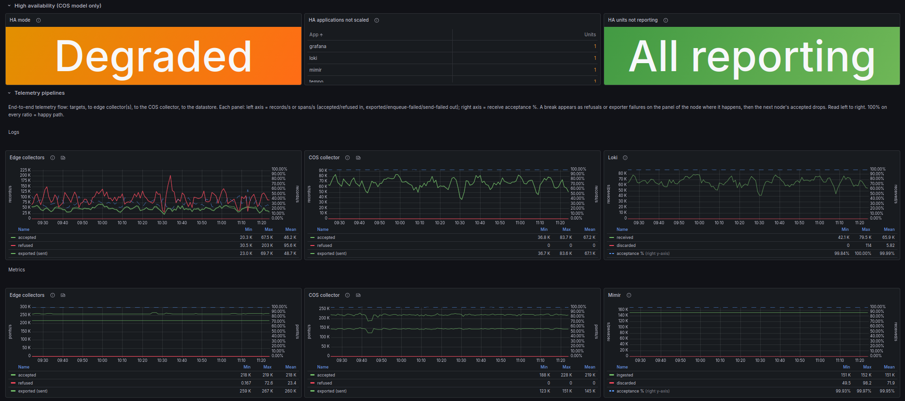

---
myst:
  html_meta:
    description: "Use the example deployment dashboard to inspect the telemetry pipeline, collector health, backends, and high availability of a COS deployment."
---

# How to use the deployment dashboard

The example Grafana deployment dashboard at [examples/deployment-dashboard.json](../../../examples/deployment-dashboard.json) provides an overview for investigating a full COS deployment. It follows telemetry from targets, to edge collectors, to the COS collector, to the backends (Mimir, Loki, Tempo), and it checks that the COS applications are scaled for high availability.

It is a template rather than a finished dashboard, so there is one variable to set after you import it, and then you sync it into Grafana.

## Set the COS model

The High availability and Backends rows are scoped to the Juju model that hosts your COS applications. Set the `COS model` variable at the top of the dashboard to that model, and those rows fill in.

Until you do, their panels read "Set the COS model" instead of showing an empty graph, so it is clear the dashboard is not yet scoped. Nothing else needs configuring: the `Collector job` variable already defaults to `otelcol-internal`, the job the collector charm uses.

## Sync the dashboard into Grafana

[Provisioning the dashboard](../integrate/sync-alert-rules-from-git-repo.md#sync-dashboards) with the cos-configuration-k8s charm keeps it in step with its source, so you never edit it in the Grafana UI. To sync the upstream example, deploy the charm against this repository and point it at the `examples` directory with the following configuration: `git_repo=https://github.com/canonical/observability-stack` and `grafana_dashboards_path=examples/`.

To sync your own copy instead, copy [examples/deployment-dashboard.json](../../../examples/deployment-dashboard.json) into your own repository, edit it there, and point the charm at that repository and path.

If you only want to look at it once, import the JSON file through the Grafana import dialog instead.

## Read the dashboard

The dashboard is organized as rows, one per part of the stack.

- High availability: whether the COS applications that need more than one replica are scaled, which ones are not, and how many units are down.
- Telemetry pipelines: logs, metrics, and traces, each as a row of edge collectors, the COS collector, and the backend. Read a row left to right; a break shows as refusals or export failures at the hop where it happens.
- Backends: the Mimir, Loki, and Tempo ingesters, shown as Active, In memory, and Flushed to S3.
- Collectors: the health of the collectors themselves. The filter and exporter queue indicate telemetry processing within pipelines.

## See also

- [Deployment topology best practices](../../reference/topology)
- [Sync alert rules and dashboards from a git repository](../integrate/sync-alert-rules-from-git-repo)
