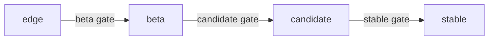

# Solution tests

For a given solution (e.g. `cos`, `cos-lite`), the solution tests deploy that
solution's Terraform module and run a set of assertions on the resulting deployment, to verify
all works as expected.

CI discovers solutions dynamically (any directory under `tests/solution/` containing a
`terraform/` subdirectory) and runs these tests as the [candidate quality gate](#quality-gates).
See `solution.just` for how these tests are invoked.

## Prerequisites

- `terraform` or `opentofu`, and `just` (`sudo snap install terraform --classic`,
  `sudo snap install astral-uv --classic`, etc. -- or use `concierge`, as CI does).
- A bootstrapped Juju controller with a Kubernetes cloud, e.g. a local `microk8s` controller.

Both the Juju Terraform provider and [jubilant](https://github.com/canonical/jubilant) deploy to
whichever Juju controller is currently active (`juju switch`) -- run `juju switch <controller>`
to your intended controller first if you have more than one registered, so you don't
accidentally deploy into the wrong one. `just solution test` prints the current
controller/model (`juju whoami`) as a sanity check before it does anything.

## Running a solution test

From the repo root:

```bash
just solution test cos-lite   # or: cos
```

This first `terraform init`s and `terraform apply`s the solution's Terraform wrapper module
(`tests/solution/<name>/terraform/`) into a new model on the current controller, then runs that
solution's `pytest-bdd` scenarios (`tests/solution/<name>/test_solution.py`) against it. pytest
itself deploys nothing.

The Terraform module is *not* destroyed automatically afterwards (so you can inspect a failure).
In CI, a failed job uploads a [juju-lens](https://github.com/lucabello/juju-lens) recording of
the run as an artifact. Clean up when you're done:

```bash
terraform -chdir=tests/solution/cos-lite/terraform destroy -auto-approve
```

In `external-ca=true` mode this same command also tears down the external-CA model, since
it lives in the same Terraform state as the solution model.

### Running a specific mode

`--internal-tls`, `--external-ca`, and `--ingress` (`true`, `false`) select the deployment
shape, and are passed to the Terraform wrapper. `just --usage solution test` lists them with their
defaults. Arguments after `--` go to pytest:

```bash
just solution test cos-lite --internal-tls=false --external-ca=true --ingress=true -- -k tls
```

`--external-ca=true` with `--ingress=false` is rejected before anything gets deployed:
without ingress the product module leaves the external-CA wiring as a no-op, so the combination
has nothing to assert.

### Running against another model

The tests look for the solution in the model named after its directory (`cos-lite`, `cos`), which
is what its Terraform wrapper deploys into. Set `SOLUTION_MODEL` (optionally
`<controller>:<model>`) to use another model:

```bash
cd tests/solution
SOLUTION_MODEL="microk8s-localhost:cos-lite" uv run --frozen --isolated pytest -vv --capture=no cos-lite
```

The mode is always read from the Terraform wrapper's outputs, so its state must be there: the
tests only run against a deployment made by `just solution test` (or by applying the wrapper).

## Adding a new scenario

Feature files live under each solution's own `<name>/features/`. Add a new `.feature` file to
the solution(s) it applies to; if two solutions want the same capability (e.g. both scrape a
metrics backend), give each its own copy naming its own workload rather than sharing a file --
there is no cross-solution tagging to keep in sync. Reuse the existing
steps where they apply -- most scenarios want the `Given the solution has been deployed` /
`And the model is healthy` background.

### Writing steps

Steps are declarative: each one states a fact about the system and asserts it on its own, so it
can be dropped into any scenario. These suites deploy and mutate nothing, so most scenarios are
just a background plus one or more `Then`s.

Step definitions live in `steps/`, grouped by the domain concept they talk about (e.g.
`steps/deployment.py`, `steps/telemetry.py`, `steps/grafana.py`) rather than by the feature file
that uses them. Register new modules in `conftest.py`'s `pytest_plugins`.

The mode is stated in the scenario, not read from it: a `Given the solution is deployed with
internal TLS` (see `steps/deployment.py`) skips the scenario when the deployment is in another
mode, so the scenarios' steps don't need to branch on it.

### Talking to workloads

Assertions against running workloads go through
[observability-clients](https://pypi.org/project/observability-clients/) fixtures in
`steps/clients.py`, which route through Traefik when the component has an ingress. Only
add retries where data genuinely trails active/idle (e.g. the first Prometheus scrape): put
tenacity's `retry` on the step itself, as `steps/telemetry.py` does.

## Adding a new solution

1. Create `tests/solution/<name>/terraform/main.tf` wrapping `terraform/<name>`, and
   an `outputs.tf` with the same outputs as the existing solutions (the steps read them).
2. Add an empty `tests/solution/<name>/__init__.py`.
3. Add `tests/solution/<name>/features/` with that solution's own scenarios.
4. Add `tests/solution/<name>/test_solution.py` containing:
   ```python
   from pytest_bdd import scenarios

   scenarios("features")
   ```
5. Run `just solution test <name>` to verify it.

## Quality gates

On Charmhub, a charm revision moves up through four risk levels: `edge`, `beta`, `candidate` and
`stable`. A quality gate is a workflow that runs tests and moves revisions up one level only if
every test passes. If a test fails, nothing moves. The solution tests in this directory are the
tests of the candidate gate.



Each charm has a `dev` track, built from its `main` branch, and one track per release, built from
a `track/<version>` branch (for example, Loki's `3.7` track comes from `track/3.7`). Each branch of
this repo pins one track per charm in its Terraform modules: `main` pins `dev`, and `track/3.0`
pins the tracks that make up COS 3.0.

| Step | Moves | Tests | Workflow | Runs |
|---|---|---|---|---|
| Release | new revision to `edge` | The charm's own CI (unit and integration tests) | Each charm repo's release workflow | On every merge to `main` or `track/<version>` |
| Beta gate | `edge` to `beta` | The charm's load and chaos tests, if it has them | "Beta Quality Gate" in [canonical/observability](https://github.com/canonical/observability) | Mondays 00:00 UTC, or by hand |
| Candidate gate | `beta` to `candidate` | The solution tests in this directory | "Solution tests" in this repo | The 1st of each month 03:00 UTC, or by hand |
| Stable gate | `candidate` to `stable` | The solution tests, run in the Solutions QA (SolQA) lab | "Stable quality gate" in this repo | By hand |

### Beta gate

Checks each charm and track on its own, for the charms and tracks listed in `manifest.yaml` in
`canonical/observability`. It runs `tox -e load` and `tox -e chaos` if the charm defines them,
then promotes that charm from `edge` to `beta`.

### Candidate gate

Runs once for each branch, `main` and `track/3.0`, and the branches don't affect each other. On
each branch it:

1. Deploys every solution under `tests/solution/` and runs its tests.
2. If all of them pass, promotes from `beta` to `candidate` every charm that those solutions'
   Terraform modules pin, as listed by `just solution charm-tracks <solution> <branch>`. If any
   test fails, nothing on that branch is promoted.

The gate doesn't promote the external charms that the modules also deploy: `traefik-k8s`,
`self-signed-certificates` and `s3-integrator`.

### Stable gate

Runs only for release tracks (`track/3.0` today), never for `dev`. It is a dry run by default:
it runs the tests but only prints the promotions. COS and COS Lite are handled separately. For
each one whose `candidate` revisions differ from `stable`, it:

1. Records the revisions in `candidate`.
2. Asks SolQA to deploy the product from `candidate` and then run `sqa_tests` at the repo root,
   which runs the solution tests against that deployment (see
   [Running against an already-deployed model](#running-against-an-already-deployed-model)).
3. Promotes `candidate` to `stable` only if every test passed and `candidate` has not changed
   since step 1.

### When a gate fails

The revisions stay where they are. Open the workflow run in GitHub Actions to see which test
failed. Once the test or the charm is fixed, start the workflow by hand ("Run workflow") instead
of waiting for the next scheduled run.

### Background

- Spec OB091,
  [Observability Charms Quality Gates](https://docs.google.com/document/d/1lzBw9cCEmdLoQJwLZz44gMLQNwaFd0nUTTmXzR4kcGI/edit)
  (internal), approved in April 2026.
- Beta gate: [canonical/observability#501](https://github.com/canonical/observability/pull/501).
- Candidate gate: [#477](https://github.com/canonical/observability-stack/pull/477). Solution
  tests: [#479](https://github.com/canonical/observability-stack/pull/479),
  [#489](https://github.com/canonical/observability-stack/pull/489),
  [#491](https://github.com/canonical/observability-stack/pull/491).
- Stable gate: [#520](https://github.com/canonical/observability-stack/pull/520).

### Current state (November 2026)

> [!NOTE]
> This section is a snapshot and needs to be updated as the gates change. When you fix one of
> these items, remove it from the list. When the list is empty, remove the section.

Where things differ from the design above:

- No charm has load or chaos tests yet, so the beta gate promotes without testing.
- The candidate gate has not had a successful run yet.
- `track/3.0` has no solution tests yet, so the candidate gate can't test that branch.
- The test modules in `tests/solution/<name>/terraform/` deploy from `edge`, so the candidate gate
  tests `edge` revisions but promotes `beta` ones.
- The daily "Promote Charm Train" workflow in `canonical/observability` still promotes `edge` to
  `beta` and to `candidate` on release tracks, skipping the gates.
- Until the stable gate is merged
  ([#520](https://github.com/canonical/observability-stack/pull/520)), promotion to `stable` is
  done by hand after a SolQA run, and `sqa_tests` only waits for the model to become active and
  idle.
- Nobody is notified when a gate fails.
